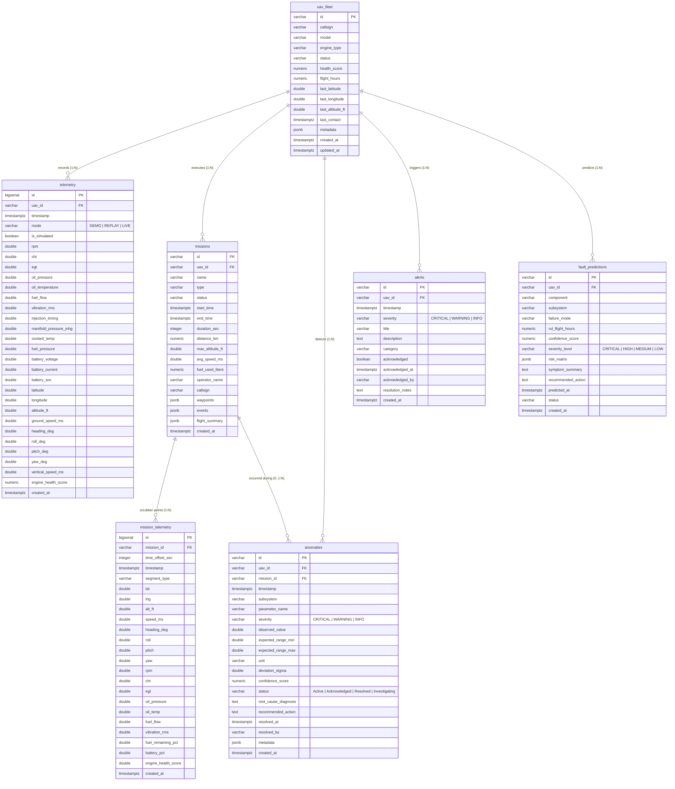

# VYOM MALE UAV Digital Twin Platform – Database Schema Documentation

**Target Database:** Supabase PostgreSQL 17  
**Project ID:** `zqwatlhbrzbghytczxat`  
**Migration:** `20261031_initial_vyom_schema`  
**Status:** PROVISIONED & VERIFIED  

---

## 1. Entity-Relationship Overview

---

## 2. Table Specifications & Schema Definitions

### 2.1 Table: `uav_fleet`
Master registry for physical & virtual unmanned aerial vehicles.

| Column | Type | Constraints | Description |
|---|---|---|---|
| `id` | VARCHAR(64) | PRIMARY KEY | Unique airframe identifier (e.g., `UAV-MALE-IND-01`) |
| `callsign` | VARCHAR(64) | NOT NULL | Tactical radio callsign (e.g., `TAPAS-BH-201 (RAV-09)`) |
| `model` | VARCHAR(128) | NOT NULL | Airframe designation (e.g., `TAPAS-BH-201 MALE UAV`) |
| `engine_type` | VARCHAR(128) | NOT NULL | Engine configuration (e.g., `Rotax 914 Turbocharged`) |
| `status` | VARCHAR(32) | DEFAULT 'standby' | Operational state (`in_flight`, `standby`, `maintenance`, `offline`) |
| `health_score` | NUMERIC(5, 2) | DEFAULT 100.0 | Overall aggregate health percentage (0.0 to 100.0%) |
| `flight_hours` | NUMERIC(8, 2) | DEFAULT 0.0 | Total cumulative engine running hours |
| `last_latitude` | DOUBLE PRECISION | NULLABLE | Last recorded GPS latitude coordinate |
| `last_longitude` | DOUBLE PRECISION | NULLABLE | Last recorded GPS longitude coordinate |
| `last_altitude_ft` | DOUBLE PRECISION | NULLABLE | Last recorded barometric/GPS altitude (feet MSL) |
| `last_contact` | TIMESTAMPTZ | DEFAULT NOW() | Timestamp of last received datalink heartbeat |
| `metadata` | JSONB | DEFAULT '{}' | Airframe specifications, dry weight, payload specs |
| `created_at` | TIMESTAMPTZ | DEFAULT NOW() | Record creation timestamp |
| `updated_at` | TIMESTAMPTZ | DEFAULT NOW() | Last update timestamp |

### 2.2 Table: `telemetry`
High-volume time-series streaming table supporting strict multi-mode ingestion (`DEMO`, `REPLAY`, `LIVE`).

| Column | Type | Constraints | Description |
|---|---|---|---|
| `id` | BIGSERIAL | PRIMARY KEY | Monotonic sequence ID |
| `uav_id` | VARCHAR(64) | FK -> `uav_fleet(id)` ON DELETE CASCADE | Associated UAV airframe |
| `timestamp` | TIMESTAMPTZ | NOT NULL | Sample epoch timestamp |
| `mode` | VARCHAR(16) | CHECK IN ('DEMO', 'REPLAY', 'LIVE') | Strict telemetry source tag |
| `is_simulated` | BOOLEAN | NOT NULL DEFAULT true | Synthetic vs. physical payload flag |
| `rpm` | DOUBLE PRECISION | NOT NULL | Engine speed (Rotations Per Minute) |
| `cht` | DOUBLE PRECISION | NOT NULL | Cylinder Head Temperature (°C) |
| `egt` | DOUBLE PRECISION | NOT NULL | Exhaust Gas Temperature (°C) |
| `oil_pressure` | DOUBLE PRECISION | NOT NULL | Engine lubrication pressure (bar) |
| `oil_temperature` | DOUBLE PRECISION | NOT NULL | Oil sump temperature (°C) |
| `fuel_flow` | DOUBLE PRECISION | NOT NULL | Instantaneous fuel consumption (L/h) |
| `vibration_rms` | DOUBLE PRECISION | NOT NULL | Crankcase root-mean-square vibration (mm/s) |
| `injection_timing` | DOUBLE PRECISION | NOT NULL | ECU electronic injection timing (° BTDC) |
| `manifold_pressure_inhg` | DOUBLE PRECISION | NULLABLE | Turbocharger boost / manifold absolute pressure |
| `coolant_temp` | DOUBLE PRECISION | NULLABLE | Cylinder head liquid coolant temperature (°C) |
| `fuel_pressure` | DOUBLE PRECISION | NULLABLE | Fuel rail delivery pressure (bar) |
| `battery_voltage` | DOUBLE PRECISION | NULLABLE | Avionics bus DC voltage (V) |
| `battery_current` | DOUBLE PRECISION | NULLABLE | Alternator / battery load current (A) |
| `battery_soc` | DOUBLE PRECISION | NULLABLE | Battery State of Charge (%) |
| `latitude` | DOUBLE PRECISION | NOT NULL | GPS Latitude (WGS84 decimal degrees) |
| `longitude` | DOUBLE PRECISION | NOT NULL | GPS Longitude (WGS84 decimal degrees) |
| `altitude_ft` | DOUBLE PRECISION | NOT NULL | True altitude above mean sea level (MSL ft) |
| `ground_speed_ms` | DOUBLE PRECISION | NOT NULL | Ground track speed (meters per second) |
| `heading_deg` | DOUBLE PRECISION | NOT NULL | Aircraft magnetic heading (0° - 359°) |
| `roll_deg` | DOUBLE PRECISION | DEFAULT 0.0 | Attitude roll angle (degrees, bank) |
| `pitch_deg` | DOUBLE PRECISION | DEFAULT 0.0 | Attitude pitch angle (degrees, climb/dive) |
| `yaw_deg` | DOUBLE PRECISION | DEFAULT 0.0 | Heading yaw angle (degrees) |
| `vertical_speed_ms` | DOUBLE PRECISION | DEFAULT 0.0 | Variometer rate of climb/descent (m/s) |
| `engine_health_score` | NUMERIC(5, 2) | DEFAULT 100.0 | Instantaneous calculated health metric |
| `created_at` | TIMESTAMPTZ | DEFAULT NOW() | Database ingestion timestamp |

### 2.3 Table: `missions`
Operational sorties, flight plans, and summarized sortie logs.

| Column | Type | Constraints | Description |
|---|---|---|---|
| `id` | VARCHAR(64) | PRIMARY KEY | Unique sortie identifier (e.g., `Surveillance_2026_10_23_01`) |
| `uav_id` | VARCHAR(64) | FK -> `uav_fleet(id)` ON DELETE SET NULL | Assigned UAV airframe |
| `name` | VARCHAR(255) | NOT NULL | Mission title / tactical descriptor |
| `type` | VARCHAR(64) | DEFAULT 'Surveillance' | Sortie classification |
| `status` | VARCHAR(32) | DEFAULT 'completed' | Mission lifecycle state |
| `start_time` | TIMESTAMPTZ | NOT NULL | Wheels-up / engine start timestamp |
| `end_time` | TIMESTAMPTZ | NULLABLE | Touchdown / shutdown timestamp |
| `duration_sec` | INTEGER | DEFAULT 0 | Total flight duration in seconds |
| `distance_km` | NUMERIC(8, 2) | DEFAULT 0.0 | Total ground track distance covered |
| `max_altitude_ft` | DOUBLE PRECISION | DEFAULT 0.0 | Peak ceiling reached (ft MSL) |
| `avg_speed_ms` | DOUBLE PRECISION | DEFAULT 0.0 | Mean ground speed throughout sortie |
| `fuel_used_liters` | NUMERIC(6, 2) | DEFAULT 0.0 | Total fuel burn (L) |
| `operator_name` | VARCHAR(128) | DEFAULT 'Omkar Sahu' | Tactical UAV Pilot in Command |
| `callsign` | VARCHAR(64) | NULLABLE | Sortie radio callsign |
| `waypoints` | JSONB | DEFAULT '[]' | JSON array of route waypoints with coordinates and altitudes |
| `events` | JSONB | DEFAULT '[]' | Chronological flight events and mode switches |
| `flight_summary` | JSONB | DEFAULT '{}' | Aggregated telemetry analysis summary |
| `created_at` | TIMESTAMPTZ | DEFAULT NOW() | Record creation timestamp |

### 2.4 Table: `mission_telemetry`
Pre-indexed flight timeline coordinates and engine snapshots used for zero-latency scrubber playback.

| Column | Type | Constraints | Description |
|---|---|---|---|
| `id` | BIGSERIAL | PRIMARY KEY | Sequence ID |
| `mission_id` | VARCHAR(64) | FK -> `missions(id)` ON DELETE CASCADE | Associated mission |
| `time_offset_sec` | INTEGER | NOT NULL | Playback offset in seconds from sortie start |
| `timestamp` | TIMESTAMPTZ | NOT NULL | Sample wall-clock timestamp |
| `segment_type` | VARCHAR(64) | DEFAULT 'Normal Flight' | Flight corridor classification |
| `lat` | DOUBLE PRECISION | NOT NULL | Latitude |
| `lng` | DOUBLE PRECISION | NOT NULL | Longitude |
| `alt_ft` | DOUBLE PRECISION | NOT NULL | Altitude (ft MSL) |
| `speed_ms` | DOUBLE PRECISION | NOT NULL | Speed (m/s) |
| `heading_deg` | DOUBLE PRECISION | NOT NULL | Heading angle |
| `roll` | DOUBLE PRECISION | DEFAULT 0.0 | Attitude roll |
| `pitch` | DOUBLE PRECISION | DEFAULT 0.0 | Attitude pitch |
| `yaw` | DOUBLE PRECISION | DEFAULT 0.0 | Attitude yaw |
| `rpm` | DOUBLE PRECISION | NOT NULL | Engine RPM |
| `cht` | DOUBLE PRECISION | NOT NULL | Cylinder Head Temp (°C) |
| `egt` | DOUBLE PRECISION | NOT NULL | Exhaust Gas Temp (°C) |
| `oil_pressure` | DOUBLE PRECISION | NOT NULL | Oil Pressure (bar) |
| `oil_temp` | DOUBLE PRECISION | NOT NULL | Oil Temp (°C) |
| `fuel_flow` | DOUBLE PRECISION | NOT NULL | Fuel Flow (L/h) |
| `vibration_rms` | DOUBLE PRECISION | NOT NULL | Vibration RMS (mm/s) |
| `fuel_remaining_pct` | DOUBLE PRECISION | DEFAULT 100.0 | Remaining fuel reserve (%) |
| `battery_pct` | DOUBLE PRECISION | DEFAULT 100.0 | Avionics battery percentage |
| `engine_health_score` | DOUBLE PRECISION | DEFAULT 100.0 | Instantaneous health score |
| `created_at` | TIMESTAMPTZ | DEFAULT NOW() | Record creation timestamp |

*Constraint:* `UNIQUE (mission_id, time_offset_sec)` ensures O(1) index seeking for timeline scrubber.

### 2.5 Table: `anomalies`
Statistical and ML-identified thermodynamic, mechanical, and electrical parameter deviations.

| Column | Type | Constraints | Description |
|---|---|---|---|
| `id` | VARCHAR(64) | PRIMARY KEY | Unique anomaly tag (e.g. `ANOM-2026-001`) |
| `uav_id` | VARCHAR(64) | FK -> `uav_fleet(id)` ON DELETE CASCADE | Associated airframe |
| `mission_id` | VARCHAR(64) | FK -> `missions(id)` ON DELETE SET NULL | Optional flight context |
| `timestamp` | TIMESTAMPTZ | DEFAULT NOW() | Time of anomaly detection |
| `subsystem` | VARCHAR(64) | NOT NULL | Engine subsystem (`Thermodynamics`, `Lubrication`, etc.) |
| `parameter_name` | VARCHAR(64) | NOT NULL | Parameter affected (`CHT Cylinder 3`, `Oil Pressure`) |
| `severity` | VARCHAR(16) | CHECK IN ('CRITICAL', 'WARNING', 'INFO') | Anomaly severity |
| `observed_value` | DOUBLE PRECISION | NOT NULL | Telemetry value that triggered anomaly |
| `expected_range_min` | DOUBLE PRECISION | NULLABLE | Normal operational lower bound |
| `expected_range_max` | DOUBLE PRECISION | NULLABLE | Normal operational upper bound |
| `unit` | VARCHAR(16) | NULLABLE | Physical measurement unit |
| `deviation_sigma` | DOUBLE PRECISION | NULLABLE | Statistical z-score standard deviation |
| `confidence_score` | NUMERIC(4, 3) | NULLABLE | ML model classification confidence (0.000 to 1.000) |
| `status` | VARCHAR(32) | CHECK IN ('Active', 'Acknowledged', 'Resolved', 'Investigating') | Current resolution status |
| `root_cause_diagnosis` | TEXT | NULLABLE | Diagnostic engine assessment |
| `recommended_action` | TEXT | NULLABLE | Operational mitigation guidance |
| `resolved_at` | TIMESTAMPTZ | NULLABLE | Resolution timestamp |
| `resolved_by` | VARCHAR(128) | NULLABLE | Engineer / operator who cleared the condition |
| `metadata` | JSONB | DEFAULT '{}' | Waveform snapshots, FFT data |
| `created_at` | TIMESTAMPTZ | DEFAULT NOW() | Ingestion timestamp |

### 2.6 Table: `alerts`
Real-time critical alarms, warnings, and operational notifications.

| Column | Type | Constraints | Description |
|---|---|---|---|
| `id` | VARCHAR(64) | PRIMARY KEY | Unique alert tag (e.g., `ALT-2026-001`) |
| `uav_id` | VARCHAR(64) | FK -> `uav_fleet(id)` ON DELETE CASCADE | Target airframe |
| `timestamp` | TIMESTAMPTZ | DEFAULT NOW() | Alarm trigger timestamp |
| `severity` | VARCHAR(16) | CHECK IN ('CRITICAL', 'WARNING', 'INFO') | Threat priority level |
| `title` | VARCHAR(255) | NOT NULL | Concise alert header |
| `description` | TEXT | NOT NULL | Detailed event description and context |
| `category` | VARCHAR(64) | NOT NULL | Alert category (`Engine Health`, `Lubrication`, etc.) |
| `acknowledged` | BOOLEAN | DEFAULT false | Operator acknowledgment state |
| `acknowledged_at` | TIMESTAMPTZ | NULLABLE | Timestamp of operator acknowledgment |
| `acknowledged_by` | VARCHAR(128) | NULLABLE | Operator username |
| `resolution_notes` | TEXT | NULLABLE | Maintenance action notes |
| `created_at` | TIMESTAMPTZ | DEFAULT NOW() | Ingestion timestamp |

### 2.7 Table: `fault_predictions`
Prognostic health management Remaining Useful Life (RUL) estimations.

| Column | Type | Constraints | Description |
|---|---|---|---|
| `id` | VARCHAR(64) | PRIMARY KEY | Unique prediction ID (e.g., `PRED-2026-001`) |
| `uav_id` | VARCHAR(64) | FK -> `uav_fleet(id)` ON DELETE CASCADE | Airframe |
| `component` | VARCHAR(128) | NOT NULL | Specific component (`Cylinder Head #3 Cooling Baffle`) |
| `subsystem` | VARCHAR(64) | NOT NULL | Subsystem classification |
| `failure_mode` | VARCHAR(255) | NOT NULL | Predicted degradation mode (`Thermal fatigue cracking`) |
| `rul_flight_hours` | NUMERIC(6, 1) | NOT NULL | Predicted Remaining Useful Life in flight hours |
| `confidence_score` | NUMERIC(4, 3) | NOT NULL | Model confidence metric (0.000 to 1.000) |
| `severity_level` | VARCHAR(16) | CHECK IN ('CRITICAL', 'HIGH', 'MEDIUM', 'LOW') | Risk severity |
| `risk_matrix` | JSONB | DEFAULT '{}' | Failure probabilities at horizons (`{"10h": 0.22, "25h": 0.68}`) |
| `symptom_summary` | TEXT | NULLABLE | Observed physical symptom precursors |
| `recommended_action` | TEXT | NULLABLE | Prescribed preventive maintenance intervention |
| `predicted_at` | TIMESTAMPTZ | DEFAULT NOW() | Calculation timestamp |
| `status` | VARCHAR(32) | DEFAULT 'Active' | Lifecycle status |
| `created_at` | TIMESTAMPTZ | DEFAULT NOW() | Record creation timestamp |

---

## 3. High-Performance Index Specifications

| Table | Index Name | Columns / Expressions | Optimization Purpose |
|---|---|---|---|
| `telemetry` | `idx_telemetry_uav_ts` | `(uav_id, timestamp DESC)` | Instantaneous retrieval of latest UAV telemetry |
| `telemetry` | `idx_telemetry_mode_ts` | `(mode, timestamp DESC)` | Zero-cross-talk queries for DEMO vs LIVE vs REPLAY modes |
| `telemetry` | `idx_telemetry_ts` | `(timestamp DESC)` | Global time-series rollups and dashboard metrics |
| `mission_telemetry` | `idx_mission_telem_seek` | `(mission_id, time_offset_sec ASC)` | O(1) seek performance for interactive scrubber bar |
| `mission_telemetry` | `idx_mission_telem_ts` | `(mission_id, timestamp ASC)` | Sequential mission route plotting |
| `anomalies` | `idx_anomalies_uav_ts` | `(uav_id, timestamp DESC)` | Recent anomaly feed for airframe |
| `anomalies` | `idx_anomalies_status_sev` | `(status, severity)` | Active high-priority anomaly dashboard badge counting |
| `alerts` | `idx_alerts_uav_ts` | `(uav_id, timestamp DESC)` | Recent alert history view |
| `alerts` | `idx_alerts_ack_sev` | `(acknowledged, severity)` | Unacknowledged active critical alert counters |
| `fault_predictions`| `idx_predictions_uav_status` | `(uav_id, status)` | Active predictive maintenance schedules |
| `fault_predictions`| `idx_predictions_sev` | `(severity_level)` | High-risk impending failure prioritization |

---

## 4. Row Level Security (RLS) & Realtime Policies

1. **RLS Enabled:** All 7 tables (`uav_fleet`, `telemetry`, `missions`, `mission_telemetry`, `anomalies`, `alerts`, `fault_predictions`) have `ROW LEVEL SECURITY` strictly enabled.
2. **Public Read Access:** Authenticated users, operators, and public dashboard viewers can read operational telemetry, fleet status, and active alerts (`FOR SELECT USING (true)`).
3. **Privileged Write Access:** Write access (`INSERT`, `UPDATE`, `DELETE`) is restricted to the backend service role and authenticated operations (`FOR ALL USING (true) WITH CHECK (true)`).
4. **Supabase Realtime:** Enabled on `telemetry`, `alerts`, `anomalies`, and `uav_fleet` via the `supabase_realtime` publication, powering instant UI updates via WebSocket without polling.

